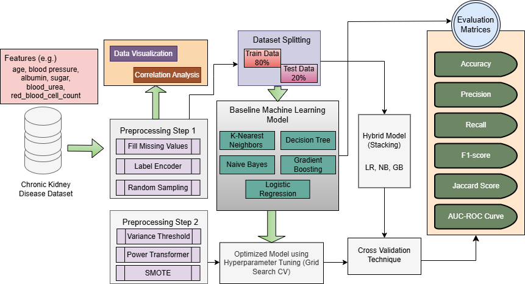
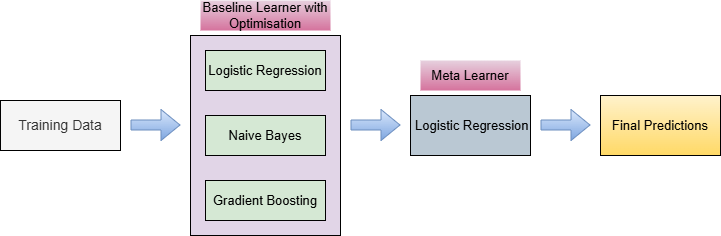
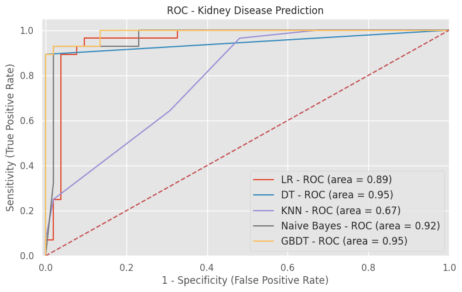
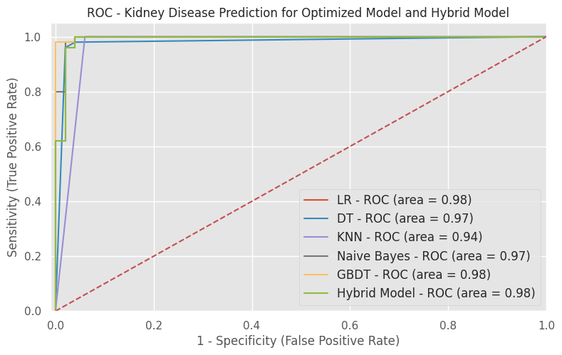
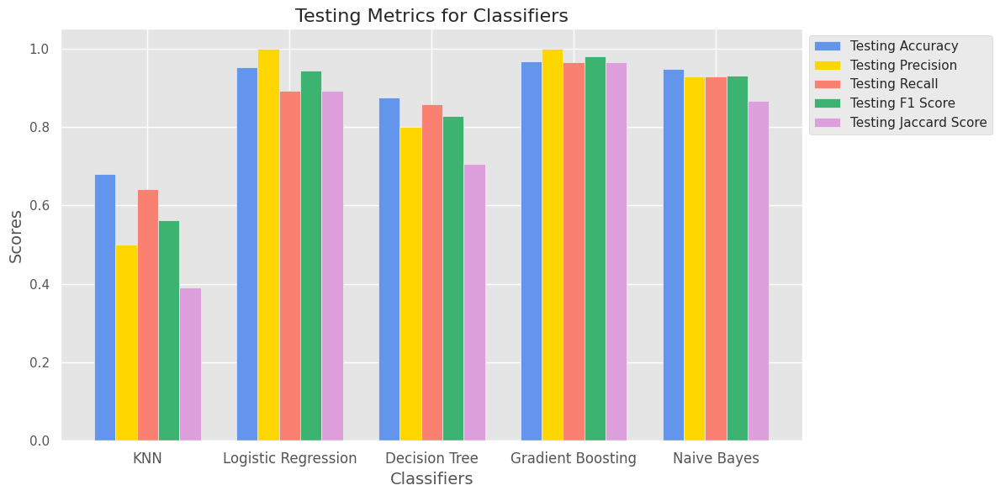
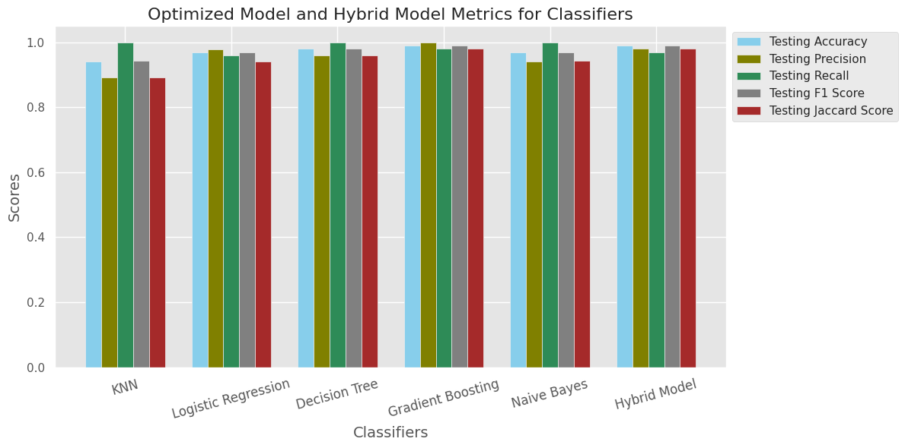

<div align="center">

# Optimized Machine Learning Models and Stacking Hybrid Approach for Chronic Kidney Disease Prediction

**Md Sharifuzzaman, Nafiz Fahad, Riadul Islam Rabbi, Ridwan Jamal Sadib, Ekramul Haque Tusher, Tze Hui Liew, Mohammad Naimul Islam, Md Saef Ullah Miah, Md. Jakir Hossen**

*21st IFIP WG 12.5 International Conference on Artificial Intelligence Applications and Innovations (AIAI 2025), Limassol, Cyprus*

[](https://doi.org/10.1007/978-3-031-96235-6_15)
[](https://doi.org/10.1007/978-3-031-96235-6_15)
[](docs/paper/Sharifuzzaman_2025_CKD_Stacking_Hybrid_AIAI.pdf)
[](https://www.python.org/)
[](https://scikit-learn.org/)
[](LICENSE)

</div>

---

## Overview

Chronic Kidney Disease (CKD) is often silent until its late stages, so early detection matters. This repository contains the data, code and notebook behind our AIAI 2025 paper, which:

- benchmarks five classic classifiers: **K-Nearest Neighbours, Decision Tree, Logistic Regression, Gradient Boosting and Naïve Bayes**
- adds a **two-step preprocessing pipeline**: imputation, label encoding and random sampling, then variance threshold, power transform and **SMOTE**
- tunes every model with **GridSearchCV (5-fold CV)**
- combines the three strongest tuned models (**LR + NB + GB**) into a **stacking hybrid** with a Logistic Regression meta-learner

The stacking hybrid reaches **99.0% accuracy, 100% recall and 0.99 F1** on the held-out test set.

<p align="center">
  
  <br><em>Figure 1. Workflow of the proposed system.</em>
</p>

## Repository Structure

```
.
├── data/
│   ├── README.md                 # dataset description and source
│   └── original/
│       └── kidney_disease.csv    # CKD dataset (400 records × 26 columns)
├── notebooks/
│   └── CKD_Prediction_Stacking_Hybrid.ipynb   # original research notebook (EDA + experiments)
├── src/
│   └── ckd_pipeline.py           # clean, reproducible end-to-end pipeline
├── results/                      # metrics (CSV/JSON) and ROC curves produced by the pipeline
├── docs/
│   ├── figures/                  # figures used in the paper
│   └── paper/                    # camera-ready PDF of the paper
├── legacy/                       # earlier Flask demo app (not maintained)
├── requirements.txt
├── CITATION.cff
└── LICENSE
```

## Dataset

| Property | Value |
|---|---|
| Source | Chronic Kidney Disease dataset (UCI / IEEE DataPort), collected at a hospital in Karaikudi, India |
| Records | 400 (250 CKD, 150 not CKD) |
| Features | 24 clinical attributes (11 numeric, 13 nominal) + class label |
| Examples | age, blood pressure, specific gravity, albumin, serum creatinine, haemoglobin, hypertension, diabetes mellitus |

See [`data/README.md`](data/README.md) for the full attribute list.

## Methodology

| Stage | Steps |
|---|---|
| **Preprocessing 1** | Random-sample imputation (numeric), mode imputation (categorical), label encoding |
| **Baseline models** | KNN, DT, LR, GB, NB trained on an 80/20 split |
| **Preprocessing 2** | `VarianceThreshold(0.01)` → `PowerTransformer` → `SMOTE`, stratified 80/20 split (`random_state=42`) |
| **Optimization** | `GridSearchCV` with 5-fold cross-validation for each model |
| **Hybrid model** | `StackingClassifier`: LR + NB + GB base learners → LR meta-learner |
| **Evaluation** | Accuracy, Precision, Recall, F1-score, Jaccard score, ROC-AUC, confusion matrix |

<p align="center">
  
  <br><em>Figure 2. Stacking hybrid model architecture.</em>
</p>

## Results

### Optimized and hybrid models (test set, as reported in the paper)

| Model | Accuracy | Precision | Recall | F1-score | Jaccard |
|---|:---:|:---:|:---:|:---:|:---:|
| K-Nearest Neighbours | 96.00% | 92.59% | 100% | 96.15% | 92.59% |
| Decision Tree | 98.00% | 96.15% | 100% | 98.03% | 96.15% |
| Logistic Regression | 99.00% | 98.03% | 100% | 99.00% | 98.03% |
| Gradient Boosting | 98.00% | 96.15% | 100% | 98.04% | 96.15% |
| Naïve Bayes | 97.00% | 94.33% | 100% | 97.08% | 94.33% |
| **Stacking Hybrid (LR + NB + GB)** | **99.00%** | **98.03%** | **100%** | **99.00%** | **98.03%** |

### Baseline models (test set)

| Model | Accuracy | Precision | Recall | F1-score | Jaccard |
|---|:---:|:---:|:---:|:---:|:---:|
| K-Nearest Neighbours | 68.75% | 54.84% | 60.71% | 57.63% | 40.48% |
| Decision Tree | 95.00% | 100% | 85.71% | 92.30% | 85.71% |
| Logistic Regression | 91.25% | 86.20% | 89.28% | 87.71% | 78.12% |
| Gradient Boosting | 97.50% | 100% | 92.85% | 96.29% | 92.85% |
| Naïve Bayes | 97.50% | 96.29% | 92.85% | 94.54% | 89.65% |

<table>
  <tr>
    <td align="center"><br><em>ROC curves: baseline models</em></td>
    <td align="center"><br><em>ROC curves: optimized and hybrid models</em></td>
  </tr>
  <tr>
    <td align="center"><br><em>Baseline models: test metrics</em></td>
    <td align="center"><br><em>Optimized and hybrid models: test metrics</em></td>
  </tr>
</table>

### Best hyperparameters (GridSearchCV)

| Model | Best parameters |
|---|---|
| KNN | `algorithm='auto', leaf_size=10, metric='manhattan', n_neighbors=3, p=1, weights='uniform'` |
| Decision Tree | `criterion='gini', max_depth=5, max_features='log2', min_samples_leaf=2, min_samples_split=3, splitter='best'` |
| Logistic Regression | `C=0.2336, penalty='l2', solver='saga', max_iter=100` |
| Gradient Boosting | `learning_rate=0.001, loss='exponential', max_depth=5, max_features='sqrt', min_samples_leaf=2, min_samples_split=2, n_estimators=50, subsample=1.0` |
| Naïve Bayes | `priors=None, var_smoothing=0.1` |

## Getting Started

### 1. Clone and install

```bash
git clone https://github.com/<your-username>/<repo-name>.git
cd <repo-name>

python -m venv .venv
source .venv/bin/activate        # Windows: .venv\Scripts\activate
pip install -r requirements.txt
```

### 2. Run the pipeline

```bash
# Use the tuned hyperparameters reported in the paper (about 10 seconds)
python src/ckd_pipeline.py

# Or re-run the full GridSearchCV hyperparameter search (about 10 minutes)
python src/ckd_pipeline.py --tune
```

Metrics are printed to the console and saved to `results/`:

| File | Content |
|---|---|
| `baseline_metrics.csv` | Test metrics and confusion-matrix counts for the baseline models |
| `optimized_hybrid_metrics.csv` | Test metrics for the optimized models and the stacking hybrid |
| `best_params.json` | Hyperparameters used for each optimized model |
| `roc_baseline.png`, `roc_optimized_hybrid.png` | ROC curves |

> **Reproducibility note:** missing values are filled by random sampling, so your numbers can differ slightly from the paper. With the default seed, the pipeline reproduces the headline result: the stacking hybrid reaches **99% accuracy and 100% recall**.

### 3. Explore the notebook

```bash
jupyter notebook notebooks/CKD_Prediction_Stacking_Hybrid.ipynb
```

## Citation

If you use this work, please cite:

```bibtex
@inproceedings{sharifuzzaman2025ckd,
  title     = {Optimized Machine Learning Models and Stacking Hybrid Approach for Chronic Kidney Disease Prediction},
  author    = {Sharifuzzaman, Md and Fahad, Nafiz and Rabbi, Riadul Islam and Sadib, Ridwan Jamal and
               Tusher, Ekramul Haque and Liew, Tze Hui and Islam, Mohammad Naimul and
               Miah, Md Saef Ullah and Hossen, Md. Jakir},
  booktitle = {Artificial Intelligence Applications and Innovations (AIAI 2025)},
  series    = {IFIP Advances in Information and Communication Technology},
  volume    = {758},
  pages     = {196--212},
  publisher = {Springer, Cham},
  year      = {2025},
  doi       = {10.1007/978-3-031-96235-6_15}
}
```

## Authors and Affiliations

| Author | Affiliation |
|---|---|
| **Md Sharifuzzaman** ([ORCID](https://orcid.org/0009-0007-9873-9709)) | Information Studies, Trine University, USA |
| Nafiz Fahad | Multimedia University, Malaysia |
| Riadul Islam Rabbi | Multimedia University, Malaysia |
| Ridwan Jamal Sadib | American International University-Bangladesh |
| Ekramul Haque Tusher | Universiti Malaysia Pahang Al-Sultan Abdullah, Malaysia |
| Tze Hui Liew (corresponding) | Multimedia University, Malaysia |
| Mohammad Naimul Islam | Universiti Teknikal Malaysia Melaka, Malaysia |
| Md Saef Ullah Miah | American International University-Bangladesh |
| Md. Jakir Hossen | Multimedia University, Malaysia |

## License

The code in this repository is released under the [MIT License](LICENSE). The dataset belongs to its original authors (see [`data/README.md`](data/README.md)). The paper is © Springer Nature / IFIP; see the publisher's terms before reusing it.

## Disclaimer

This is a research project. It is **not** a medical device and must not be used for clinical diagnosis.
